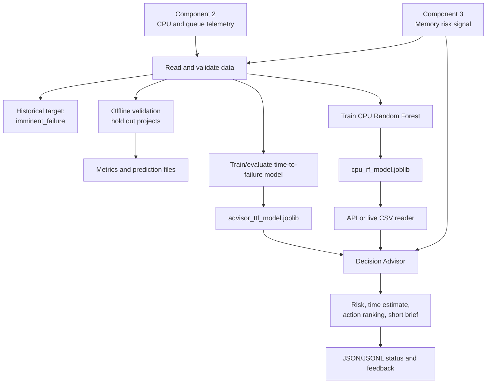

# CPU Spike Predictor: Updated Presentation and Viva Guide

This guide describes the current `cpu_spike_predictor` implementation: the CPU-failure classifier, the API and CSV live reader, and the newer Decision Advisor. It is written for a reader who is new to the technical terms. It also distinguishes code that is implemented from actions or results that are only simulated or advisory.

> **Important for the viva:** this repository contains research-prototype code and generated artifacts. Do not call it a production Kubernetes self-healing system, a validated commercial product, or a clinically/operationally proven predictor. State what the current code does and what still needs testing.

## 1. Start with the idea

Imagine a restaurant during a rush:

- The software **service** is like a team handling one kind of order.
- The **CPU** is like the workers doing the calculations. CPU percentage says how busy the computer processor is.
- A **queue** is like a line of waiting orders. If orders arrive faster than workers can complete them, the line grows.
- **Telemetry** means measurements from a running computer program: CPU use, queue size, incoming request rate, and similar values.
- A **failure** is an event marked in the historical data as a failure.

The CPU Spike Predictor looks at CPU and queue measurements and estimates the chance of an imminent CPU-related failure. Component 3 separately supplies a memory-risk prediction. The CPU model does **not** learn from memory outputs; a later decision rule may consider CPU and memory risk together.

### One-sentence explanation

> “The offline workflow learns and tests from past measurements whose outcomes are known; the live workflow uses the saved model to estimate risk from new measurements; the Decision Advisor adds a time estimate and ranked response recommendations.”

## 2. What the system contains

| Part | What it does | Beginner explanation |
|---|---|---|
| Component 2 | Produces CPU, queue, system-state, and incident data. | The source of the CPU-side measurements. |
| Component 3 | Produces memory risk, alert, and label information. | A separate source of memory-related warning signals. |
| Ingestion | Reads and checks the source data. | Makes sure the input tables have the expected columns and prepares them for the program. |
| CPU classifier | Predicts an imminent-failure probability from ten CPU/queue features. | The main pattern-learning model. |
| Time-to-failure (TTF) forecaster | Predicts approximate minutes until failure, with low/median/high estimates. | A separate model that estimates “how soon,” not just yes/no risk. |
| Decision Advisor | Compares possible responses, estimates an urgency and ranks actions. | A decision-support layer that suggests what an operator should consider. |
| FastAPI service | Receives telemetry and returns predictions through web endpoints. | A way for another program to ask this component for a result. |
| Live CSV reader | Watches upstream CSV files for newly added records. | An alternative to sending each measurement through the API. |
| Output files | Store predictions, status, evaluation metrics, and feedback. | Records that can be inspected later. |

### Architecture at a glance



**How to talk through it:** Component 2 owns CPU and queue data. Component 3 owns memory predictions. Offline, historical outcomes let us train and evaluate. We save model files. Online, the API or live reader loads those files and scores incoming measurements. The Advisor adds time-to-failure and ranks actions; it does not replace the CPU model.

## 3. The data and the target

### What the CPU model receives

The CPU classifier uses ten Component 2 fields:

| Input name | Plain explanation |
|---|---|
| `cpu_percent` | How busy the processor is, in percent. |
| `cpu_velocity` | How quickly CPU use is changing. |
| `cpu_trend_5min` | A CPU trend value calculated by Component 2 for a short period. |
| `cpu_trend_10min` | A CPU trend value calculated by Component 2 for a longer period. |
| `in_flight_queue` | Current work waiting or being handled. |
| `incoming_rate` | How quickly new requests arrive. |
| `processing_rate` | How quickly requests are completed. |
| `queue_growth_rate` | How quickly the waiting work is increasing or decreasing. |
| `queue_pressure_index` | Component 2’s calculated queue-pressure indicator. Use Component 2’s definition for its exact units. |
| `overload_flag` | A 0/1 indication from Component 2 that overload was marked. |

The field names with `5min` and `10min` reflect Component 2’s feature names. Verify actual sampling and feature-generation details before claiming that every row is exactly one minute apart.

### What is the target?

The original `label` is used to identify a recorded failure (`ground_truth_failure`). In addition, the ingestion code creates `imminent_failure`: a row is positive if failure is happening now or occurs in the next five rows.

This is a **row-based** horizon. The configuration name refers to minutes, but the code uses five rows; that only equals five minutes if there is exactly one row per minute. Say “within five rows” unless the sampling interval is verified.

The model learns from these historical examples:

```text
CPU and queue measurements  →  target answer: imminent failure yes/no
```

The **target** is the answer to learn; the **features** are the measurements used to estimate it.

### Why keep memory out of the CPU model?

Memory predictions come from another component and may already contain a warning about failure. If the CPU classifier learned from that memory prediction, its score could look strong because it received an answer-like clue rather than because CPU/queue behavior was predictive. That is called **target leakage**. This implementation keeps the model inputs to Component 2 CPU/queue fields; it uses Component 3 memory separately in decision rules.

## 4. Offline workflow: learn and check from the past

**Offline** means the program works on saved historical data. It can see the failure labels that were recorded later, so it can compare predictions with known outcomes.

### Step by step

1. **Read the two source tables.** Component 2 supplies CPU/queue measurements and failure information. Component 3 supplies memory predictions.
2. **Check and prepare them.** Ingestion checks required columns, handles timestamps, adds the imminent-failure target, and prepares the data used for analysis. A wrong input schema should produce an error rather than pretend to be valid data.
3. **Validate the classifier.** With multiple projects, Leave-One-Project-Out (LOPO) means: hold out one whole project, train on the others, test on the held-out project, then repeat for other projects. If there is only one project, the classifier code falls back to an 80/20 row split.
4. **Calculate evaluation metrics.** The program compares model alarms with known target labels and saves metrics and row-level predictions.
5. **Analyze warning lead time.** The program checks whether an alarm appeared before each recorded failure in the lookback window. This analysis is possible because the historical failure times are known.
6. **Train the saved CPU model.** The separate `train` command trains on available data and saves `outputs/cpu_rf_model.joblib`.
7. **Run the Advisor evaluation separately.** `src.advisor.evaluate` compares the classifier/fallback policy with additional modules such as the time-to-failure forecaster, calibration analysis, decision-cost policy, and alert grouping. It writes `advisor_*` output files.

### What is LOPO useful for?

If we split random rows, very similar behavior from one project might occur in both training and test data. That can make a model appear to generalize when it has only learned that project's patterns. LOPO keeps one whole project out, giving a more demanding test of whether patterns transfer.

LOPO is still not proof that the model will work everywhere. It only measures performance on the projects and data represented in that evaluation.

### What the classifier is

The CPU classifier is a **Random Forest** with 100 decision trees by default. A decision tree is a chain of simple questions about measurements. A Random Forest combines many trees’ outputs into one score. `class_weight="balanced"` gives more training importance to the less common class; it does not fix missing data, bad labels, or dataset imbalance by itself.

The score is between 0 and 1. The standard CPU alarm threshold is 0.60: a score at or above 0.60 is treated as an alarm by the base decision policy. This is a chosen operating cutoff, not a universal scientific boundary.

### Offline results: report carefully

The saved Advisor evaluation (`outputs/advisor_thesis_table.md` and `outputs/advisor_evaluation_summary.json`, generated on 2026-10-18) explicitly warns that the current source data no longer reproduces the older classifier headline of F1 0.9513. The current evaluation frame is reported as 71,355 rows across six projects, with 79 recorded failure onsets. The file reports the current RF baseline as:

| Metric | Saved current-frame result |
|---|---:|
| Precision | 0.5912 |
| Recall | 0.5433 |
| F1 | 0.5662 |
| False alarm rate | 0.9966 |

The very high false-alarm rate is a major limitation, not a result to hide. The evaluation notes explain that project/class distribution is highly imbalanced and some held-out folds contain very few healthy rows. Do **not** use the old saved result (0.9513 F1) as a current result unless you can regenerate it from the final input data and show that exact run.

The saved time-to-failure evaluation reports mean TTF MAE of about **5.002 minutes** in the Advisor thesis table. A separate `advisor_forecast_summary.json` reports different summary metrics and MAE. Those artifacts are not numerically consistent; before presenting TTF scores, rerun the evaluation, verify all outputs were generated from the same data/run, and use one clearly identified report. Do not combine values from different artifacts.

The calibration artifact also reports that calibration did **not** improve ECE/Brier in that run, and its conformal coverage was well below the intended 90% target. Therefore, describe calibration and uncertainty handling as implemented and evaluated, but not as successfully validated by those current saved results.

## 5. Online workflow: use the saved model on new data

**Online/live** means scoring new telemetry as it arrives. The model does not know the future outcome of a new row. It can estimate risk; later, when the outcome becomes known, that row can be considered in future offline evaluation.

### Two ways to send new measurements

1. **API route:** an upstream program sends a JSON payload to the FastAPI `/predict` endpoint (or multiple services to `/batch_predict`).
2. **Live CSV reader:** the `live` command repeatedly checks Component 2 and Component 3 CSVs for new rows, predicts, and writes JSONL and JSON outputs.

These are alternate ways to deliver telemetry to inference. Neither one trains the model. Both need a compatible trained CPU model file.

### What happens to one live measurement?

1. Load the saved CPU model.
2. Receive the service name, CPU/queue inputs, and optional memory data. If the API receives an all-zero CPU block (as can happen with a memory-only update), it can reuse a genuinely measured CPU prediction for that service only if that CPU measurement is no more than 30 seconds old. This avoids overwriting recent CPU status with a meaningless all-zero baseline. If the saved CPU sample is older, it is not reused.
3. Put the ten CPU values in the form expected by the model.
4. Produce a CPU failure-risk score.
5. Apply the CPU and memory alarm rules.
6. Return or record a warning, recommendation, and explanation.
7. Observe what actually happens later; only then can correctness be checked.

For a simple example, suppose a live service reports high CPU and an increasing queue. If the classifier score is 0.72, that is above the 0.60 CPU threshold. If memory also triggers its alarm (memory probability at least 0.70, an affirmative alert, or a WARNING/FAILURE label), the base policy selects the combined critical recommendation. If memory does not alarm, it selects the CPU-only load-shedding recommendation. The 0.72 is a model estimate, not a promise that failure will happen.

### Live file reading, timing, and outputs

The live reader supports a polling interval. The `LiveInferenceEngine` class default is one second, but the CLI `python -m src.cli live` passes a default of **five seconds**. You can change it with `--poll-interval`. For the viva, distinguish the class default from the CLI command default.

The reader keeps a **checkpoint**, a saved note of how many Component 2 rows and which Component 3 records it processed. This helps it continue without replaying the entire history. It reads the source CSV files without modifying them and has retry handling for partial writes. Main outputs include:

- `outputs/live_predictions.jsonl`: one prediction record per line.
- `outputs/live_status.json`: latest status by service.
- `outputs/live_log.jsonl`: bounded API prediction log.
- `outputs/.inference_checkpoint.json`: live reader progress.

The API health endpoint says whether the process is alive. The readiness endpoint says whether its model is loaded and it is ready to predict.

## 6. The updated Decision Advisor

The Advisor is an extra decision-support layer added on top of the CPU classifier and the older CPU/memory threshold matrix. It combines several ideas, but its recommendations are still prototype outputs that need evaluation.

### 6.1 Time-to-failure forecast

The separate forecaster estimates how many minutes remain until failure and provides three estimates:

- **p10:** a lower estimate; roughly 10% of outcomes would be expected below this value under a well-calibrated model.
- **p50:** the middle/median estimate.
- **p90:** a higher estimate.

The model creates extra time-pattern inputs from CPU/queue measurements: previous values (**lags**), recent averages, recent variation, and changes between rows. These extra inputs are still derived from Component 2; the code has a guard against memory-derived fields entering the model.

The forecaster uses XGBoost quantile regression when available, or a scikit-learn quantile-regression fallback. Its target is time-to-failure capped at 30 minutes. The lag and rolling windows are row-based, so their interpretation depends on measurement spacing.

In `/api/advisor/decide`, a true temporal forecast is used only if a forecaster artifact is loaded **and** the caller supplies recent CPU history. Otherwise the endpoint uses a simple risk-to-time proxy: higher risk means less estimated time. That proxy is a rule, not a separately observed time forecast. Its p10/p90 band is also heuristic.

The live CSV reader currently uses a risk-based TTF proxy for its Advisor enrichment; it does not build the temporal history forecast on that path. Do not describe every live TTF value as coming from the forecaster model.

### 6.2 Cost-sensitive action ranking

The Advisor scores candidate actions using an assumed failure cost, each action’s assumed disruption cost and effectiveness, and whether the action can finish before the estimated failure. It returns a recommended action and up to three ranked options.

Candidate actions include:

- `NO_ACTION`: continue monitoring.
- `LOAD_SHEDDING`: reduce some incoming work quickly.
- `SCALE_OUT`: add service replicas (copies of the service).
- `PROACTIVE_RESTART`: restart a service pod.
- `CRITICAL_RESTART_AND_REROUTE`: isolate/restart and route work elsewhere.

“Expected cost” is a score calculated from values coded in `src/advisor/policy.py`; it is **not** a measured dollar amount or a business-approved cost model. The CPU and memory risk combination assumes independent channels. Real systems may violate that assumption.

The API also returns a fallback action from the older deterministic CPU/memory threshold matrix. It flags operator approval for actions above Tier 1. The Advisor endpoint itself returns a recommendation; it does not execute a real cluster operation.

### 6.3 Confidence and human review

The Advisor’s `confidence` is based on the cost difference between the best and second-best candidate actions. It is **not** a statistical confidence that the failure probability is correct. The returned confidence band is a fixed plus/minus 0.15 display band, not a calibrated interval.

The API marks review as needed when CPU risk is in the fixed range 0.45 to 0.65. This is a simple gray-zone rule. Although an offline conformal-prediction module is present, the live Advisor endpoint does not use that offline conformal result to set this flag.

Similarly, the calibration module is used by offline evaluation, but the current `/predict` and `/api/advisor/decide` routes obtain their risk score directly from the saved Random Forest. Do not imply that the live score has been calibrated by that module.

### 6.4 Explanation and short brief

The Advisor creates a short plain-language brief. It can use TreeSHAP attribution if the SHAP explainer is available; otherwise it uses the existing approximate attribution method. The regular `/predict` RCA uses the approximate attribution method. TreeSHAP helps describe how individual inputs influenced a model score; it does not prove a cause or explain causation.

An optional language-model (LLM) enrichment is disabled by default. It is only considered when the request opts in and the relevant environment configuration is enabled. The normal brief is a deterministic template, so the default path does not need an external language model.

### 6.5 Fleet prioritisation, alert grouping, and drift

- **Prioritisation** ranks services by a combination of risk, estimated time pressure, business criticality, and number of dependent services. It is implemented in a module; do not claim a REST fleet-ranking endpoint unless one has been added.
- **Cascade grouping** groups alerts that share dependencies or an incident ID. “Patient zero” here means the highest-urgency service in the group, not necessarily a scientifically proven root cause.
- **Drift detection** looks for changes in score distributions or prediction errors over time. It can recommend keeping thresholds, adjusting a threshold, or retraining. Threshold suggestions are recorded and not silently applied.
- **Feedback logging** records whether an operator accepted, ignored, or overrode a recommendation, plus any later outcome. This can provide evidence for later offline evaluation.

## 7. API endpoints and what they mean

The API is available at `http://127.0.0.1:8000` when started locally. FastAPI also provides an interactive request page at `/docs`.

| Endpoint | What it does |
|---|---|
| `GET /health` or `GET /healthz/liveness` | Says the API process is alive. |
| `GET /healthz/readiness` | Confirms the base model is loaded; otherwise returns not-ready. |
| `GET /metrics` | Returns basic API counters and whether the model is loaded. |
| `POST /predict` | Returns base CPU/memory alarms, recommendation, RCA fields, runbook and a generated mitigation command/result. A memory-only all-zero CPU update can reuse a real CPU result from that service for up to 30 seconds. |
| `POST /batch_predict` | Applies the base prediction route to a list of service payloads. |
| `POST /api/advisor/decide` | Returns Advisor risk, action ranking, confidence fields, time-to-failure, fallback action, and short brief. |
| `GET /api/advisor/brief/{service}` | Rebuilds a brief from the service's latest live status. |
| `POST /api/advisor/feedback` | Records accepted, ignored, or overridden advice. |
| `GET /api/advisor/drift` | Returns a previously generated drift report if available. |
| `GET /api/advisor/thresholds` and `POST /api/advisor/thresholds` | Reads suggestions or records a human-approved threshold proposal; recording does not apply it to the running model. |

## 8. Safety boundary: recommendations are not real self-healing

The mitigation module creates and records Envoy/Kubernetes command strings and uses a three-minute cooldown per service. It does **not** connect to a Kubernetes cluster or execute those command strings. The `status` and `command_issued` fields are prototype bookkeeping, not proof that a pod was changed.

The Advisor also does not directly apply its recommendation. A real deployment would need authenticated callers, strict authorization, input validation, audit trails, an operator approval process, a protected action executor, rollback tests, and monitoring. Service names used in shell commands would need safe validation. Do not claim those controls are implemented unless you verify them.

## 9. How to understand the saved evaluation

Use these definitions:

- **Precision:** of the alarms raised, what fraction corresponded to imminent failure?
- **Recall:** of the imminent failures, what fraction received an alarm?
- **F1:** a combined score balancing precision and recall.
- **False alarm rate (FAR):** of healthy/negative cases, what fraction were incorrectly alarmed?
- **TTF MAE:** average absolute difference between forecast time-to-failure and the recorded target time, in minutes.
- **ECE:** Expected Calibration Error; roughly measures whether predictions reported as, for example, 70% happen about 70% of the time.
- **Brier score:** average squared error of probability predictions; lower is better.
- **Ablation:** compare a system as features are added step-by-step to see what changed.
- **Offline policy evaluation:** estimate a decision policy using logged or simulated historical decisions rather than trying it on a real service.
- **IPS/SNIPS/DR:** three statistical estimators used for that offline policy comparison. They depend on action-propensity and reward assumptions.
- **Latency p99:** 99% of measured calls in the benchmark completed no slower than this time. It describes that benchmark, not every machine or real deployment.

### What current saved files say—and their limits

The saved thesis table reports 79 failure onsets, classifier baseline F1 0.5662, and FAR 0.9966. It says the source data used for this evaluation has serious class/project imbalance and cannot reproduce the historical 0.9513 F1. The high FAR means the model alarms on almost all healthy rows in that particular current evaluation frame. This is a problem requiring investigation, not a success claim.

The same saved thesis table reports:

- Time-to-decision: 79.6 seconds baseline versus 44.8 seconds Advisor **in a deterministic simulation**, not an experiment with human operators.
- Decision accuracy: 0.0506 baseline versus 0.5823 Advisor against a constructed cost-optimal oracle. This is not normal classification accuracy and depends on the simulation's cost assumptions.
- Alert grouping: 28 raw alerts to 19 groups, 32.1% collapsed, in the evaluated example.
- Advisor-only compute p99: 0.040 ms in a 10,000-iteration microbenchmark, excluding the model's full inference and deployment/network overhead.
- Calibration: ECE/Brier did not improve in the saved run; the conformal coverage was 0.4247, below the intended 0.90 target.

There is a separate saved forecast summary with different forecast metrics from the thesis table. Treat the output directory as generated experiment artifacts, not as one guaranteed synchronized report. Before the viva, rerun the relevant evaluation on the exact final data, verify that the saved outputs came from that same run, and show the generation date and source data. Do not combine different files' metrics or claim a number that you cannot reproduce.

### How to present the evidence honestly

1. State the data source and evaluation date.
2. Say exactly which artifact/report the number comes from.
3. Label a macro-average, pooled score, simulation, and benchmark correctly.
4. Show per-project folds as well as means when possible.
5. Mention the very high current classifier FAR and the calibration issue.
6. Explain the next step: repair/verify the data and labels, rebalance the evaluation frame appropriately, rerun all modules on a common fold split, and compare against simple baselines.

## 10. Suggested presentation structure (about 10 minutes)

### Slide 1 — Project and problem (40 seconds)

“Microservices handle different jobs. When a service becomes overloaded, CPU use and waiting requests may rise. My component investigates whether these measurements can help warn about an upcoming CPU-related failure.”

### Slide 2 — Gap and objective (50 seconds)

Show your actual literature comparison: authors/system, inputs, prediction method/horizon, evaluation, and limitation. Then state your own research question. Do not invent a literature gap; connect it to the studies you actually read.

### Slide 3 — Architecture (60 seconds)

Explain Component 2 CPU/queue measurements, Component 3 memory signal, CPU classifier, Advisor layer, API/live reader, and output records. Stress that memory is not a classifier feature.

### Slide 4 — Data and labels (60 seconds)

Define one row, one timestamp, CPU, queue, feature, target, and imminent failure. Explain the five-row label and do not call it five minutes without verified sampling.

### Slide 5 — Offline workflow (60 seconds)

Explain historical data → prepare target → hold out projects → train/test → save metrics and model. Describe why old outcomes are required for evaluation.

### Slide 6 — Online workflow and demo (60 seconds)

Explain the saved model → new telemetry → risk estimate → memory decision signal → recommendation. Show `/docs`, readiness, and one valid request if the environment is ready. A live prediction cannot be judged correct until the later outcome is known.

### Slide 7 — Updated Decision Advisor (90 seconds)

Describe the added TTF forecast, action cost ranking, confidence/review flag, short brief, fleet prioritisation, cascade grouping, drift advice, and operator feedback. Make clear which pieces are in REST endpoints and which are module/evaluation capabilities.

### Slide 8 — Results (75 seconds)

Show current reproducible evaluation only. The saved thesis table's current baseline F1 is 0.5662 and FAR 0.9966; explain why the FAR is a serious limitation. If you rerun successfully, replace figures with the single fresh run and show the fold-level results.

### Slide 9 — Safety and limitations (60 seconds)

Explain that Kubernetes/Envoy commands are generated, not executed; approval is signalled, not a complete permission system. Mention data alignment, row-based windows, class imbalance, uncertain probability calibration, and non-production status.

### Slide 10 — Value and next steps (45 seconds)

Potential users include platform/SRE teams operating microservices. The path to commercialization would require interviews, a supervised pilot, measurable false-alarm and warning-time targets, security review, and verified integration. Do not invent customer demand, revenue, or market size.

## 11. Demonstration commands

Run commands from `cpu_spike_predictor`:

```powershell
.\.venv\Scripts\python.exe -m src.cli validate
.\.venv\Scripts\python.exe -m src.cli train
.\.venv\Scripts\python.exe -m src.cli serve --host 127.0.0.1 --port 8000
```

In a separate terminal for the CSV live reader:

```powershell
.\.venv\Scripts\python.exe -m src.cli live --poll-interval 5
```

The Advisor evaluation is a separate and potentially longer offline job:

```powershell
.\.venv\Scripts\python.exe -m src.advisor.evaluate
```

When the server is running, open `http://127.0.0.1:8000/docs` to view and try the current API contract. The current component folder does not contain a `dashboard/` application; do not rely on old instructions to launch `streamlit run dashboard/app.py` unless that application is restored separately.

**Demo tip:** test all commands and the sample payload before presentation day. Keep a screenshot or recorded output ready in case data paths, saved models, or service startup are unavailable.

## 12. Viva questions and sample answers

**What does your system do in simple words?**  
“It reads CPU and queue measurements, estimates imminent CPU-related failure risk, and combines that signal with separate memory warnings to produce a recommendation. The newer Advisor adds an approximate time-to-failure estimate and ranks response options.”

**Why have offline and online workflows?**  
“Offline uses old examples with known outcomes to train and evaluate. Online loads the saved model to estimate risk from new measurements whose outcomes are not known yet. The offline workflow creates the model artifact that the online workflow needs.”

**Does online retrain the model for each new record?**  
“No. It loads a saved model and runs inference. Retraining on every row would be a different design and is not how this implementation works.”

**Why use a Random Forest?**  
“It is a practical model for structured measurements and can capture nonlinear combinations without feature scaling. It is a chosen baseline, not proven to be the best model; comparison with other methods is future work.”

**Why use LOPO?**  
“It keeps a whole project out of training to test whether patterns transfer to a project the model did not see. With only one project the current classifier falls back to an 80/20 row split.”

**Why is memory not a classifier feature?**  
“Memory output belongs to Component 3 and could contain information too close to the outcome. Keeping it out reduces leakage risk and lets us test CPU/queue signals separately. The decision layer can still use the memory warning.”

**What does the probability mean?**  
“It is the model's estimated score for its defined target, not certainty. The base policy uses 0.60 as the CPU alarm cutoff. We still need better calibration evidence before treating the score as a dependable real-world probability.”

**Does it predict exactly five minutes ahead?**  
“The label code looks ahead five rows. It is five minutes only if each row is one minute apart. The current implementation should be described as row-based until sampling is verified.”

**What does the new Advisor add?**  
“It can estimate time-to-failure, compare actions using assumed costs and effectiveness, rank alternatives, produce a short brief, and flag some cases for review. These recommendations need validation and do not execute cluster operations.”

**Is the Advisor confidence a statistical confidence interval?**  
“No. The action confidence is based on the cost gap between the top choices. The displayed band is a fixed-width band. It should not be presented as a calibrated statistical interval.”

**Is the TTF prediction always a real forecast?**  
“No. The endpoint uses the temporal forecaster only when the forecaster artifact is loaded and recent CPU history is supplied. Otherwise it uses a simple risk-to-time proxy.”

**Does it use TreeSHAP?**  
“The Advisor can use TreeSHAP when its explainer is available; otherwise it uses approximate attribution. The standard RCA path uses the approximate method. Neither proves causation.”

**Does it automatically restart a real service?**  
“No. The mitigation module generates and records command strings and applies in-process cooldown bookkeeping. It does not execute commands against a real Kubernetes or Envoy deployment.”

**What is the main current weakness?**  
“The current saved evaluation has a very high false-alarm rate and data/class-distribution problems, so the older strong F1 result is not reproducible on the current evaluation frame. I must repair/verify the source data and rerun before making performance claims.”

**Can you commercialize it now?**  
“Not as a production-ready product yet. There is a potential use case in helping SRE teams prioritize service risk, but it needs a validated pilot, acceptable false-alarm rates, security controls, and integration with real monitoring and approval systems.”

## 13. Glossary: technical language in plain words

| Term | Simple meaning |
|---|---|
| AIOps | Using software/data analysis to help IT operations notice and respond to system problems. |
| API | A defined way for one program to request information or an action from another. |
| Artifact | A file produced by a program and reused later, such as a saved trained model. |
| Calibration | Checking whether a predicted percentage matches the frequency of outcomes in reality. |
| Cascade | One service problem spreading to or affecting other dependent services. |
| Classifier | A model that chooses between categories, here imminent failure vs not imminent failure. |
| Conformal prediction | A method that can return a set of plausible labels and flag ambiguous cases, under assumptions. |
| CPU | The computer part that performs instructions and calculations. |
| CSV | A plain text table with columns separated by commas. |
| Drift | A change in data or behavior so that new inputs differ from the examples used before. |
| ECE | A summary of the mismatch between predicted probabilities and observed frequencies; lower is usually better. |
| Endpoint | A particular API address, such as `/predict`. |
| Feature | An input measurement given to the model. |
| Feedback | A record of whether an operator accepted, ignored, or changed a recommendation. |
| Inference | Using an already-trained model to produce a new prediction. |
| JSON / JSONL | Structured text data; JSONL stores one JSON record on each line. |
| LLM | Large Language Model: software that generates text from supplied information. Optional in this system and off by default. |
| LOPO | Leave-One-Project-Out testing: keep one project out of training and test on it. |
| MAE | Mean Absolute Error: average size of prediction error, ignoring whether it was above or below the true value. |
| Microservice | A small software program responsible for one task within a larger application. |
| Model | Software that has learned patterns from examples. |
| p10 / p50 / p90 | Low, middle, and high quantile estimates. They are useful only if their uncertainty interpretation is validated. |
| Payload | The data sent in an API request. |
| Polling | Checking repeatedly for new data. |
| Probability | A score from 0 to 1, often displayed as 0–100%. It is an estimate, not certainty. |
| Queue | Work waiting to be processed. |
| Random Forest | A model combining many decision trees, each of which makes a sequence of simple splits/questions. |
| RCA | Root Cause Analysis: an attempt to describe what may have contributed to an incident. Model attribution is not proof of the actual cause. |
| SRE | Site Reliability Engineering: practices and people focused on keeping software services dependable. |
| Target / label | The answer the model is learning to predict. |
| Telemetry | Measurements collected from a running system. |
| Threshold | A cutoff that changes a score into a yes/no alarm. |
| TTF | Time to Failure: estimated time remaining until a failure. |
| Validation | Testing model predictions against outcomes kept out of training. |
| FAR | False Alarm Rate: share of true healthy/negative cases incorrectly alarmed. |
| F1 | One score combining precision and recall. |
| Precision | Among alarms, the fraction that were correct. |
| Recall | Among actual target failures, the fraction the model caught. |
| SHAP / TreeSHAP | A way to estimate how input features contribute to a model prediction. It explains model behavior, not causation. |
| Expected cost | A score based on assumed failure, mitigation, and delay costs; not automatically a real monetary amount. |
| IPS / SNIPS / DR | Methods for estimating a decision policy from logged/simulated choices; results depend on assumptions and data quality. |
| p99 latency | A benchmark statistic: 99% of measured calls were at or below this duration. |

## 14. Closing statement

> “CPU Spike Predictor combines a CPU/queue failure classifier with a separate Decision Advisor. Historical data supports training and evaluation; the live API or CSV reader uses saved models to score new telemetry. The Advisor adds time estimates and ranked recommendations, while leaving high-impact operations under human control. Current evaluation limitations—especially data quality, false alarms, and calibration—must be addressed before production deployment.”
